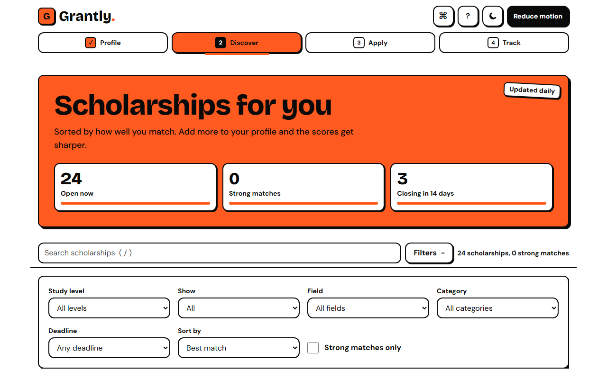
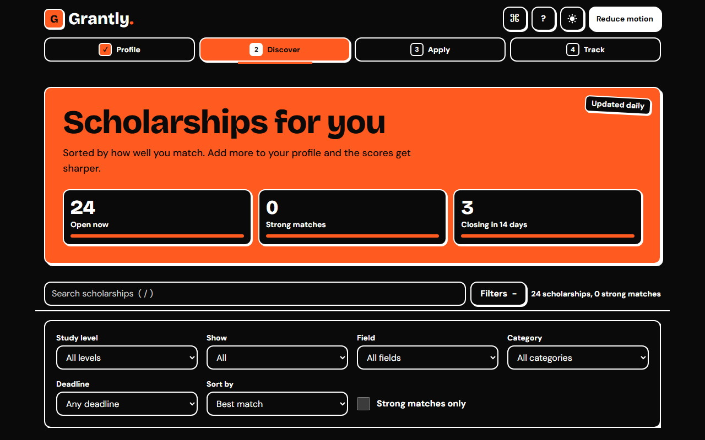
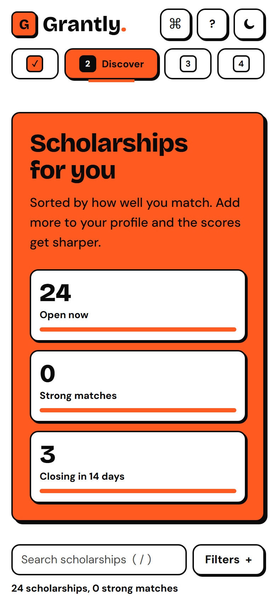

# Grantly

**A transparent scholarship workspace for Indian students.**

Grantly helps students discover scholarships, understand exactly why they do or don't qualify, and track applications and deadlines in one place. Matching runs locally in the browser, every score is explained, and the app always points to the next useful action.

[**Live demo**](https://frontend-arena-one.vercel.app) · [Demo video](./SUBMISSION_CHECKLIST.md) · [Repository](https://github.com/AKIB2005/frontend-arena)

<!-- FILL BEFORE SUBMIT: replace the "Demo video" link above with the real video URL. -->

<!-- FILL BEFORE SUBMIT: capture these three screenshots into docs/screenshots/ with these exact names, then keep this table. -->

| Light desktop | Dark desktop | Mobile |
| --- | --- | --- |
|  |  |  |

## Highlights

- **Match score you can read:** each scholarship shows a ring plus a checklist of criteria that are met, not met, or not yet checked.
- **Live match lab on the home page:** move income, percentage, category, or gender and watch a ranked shortlist reorder in real time.
- **Real and sample data, clearly labeled:** real records link to their official pages and show the date they were checked.
- **Tracker with documents and deadlines:** move scholarships through stages, tick off documents, and export open deadlines to a calendar.
- **Accessible by design:** keyboard-first, readable in light and dark themes, states shown with icons and text rather than color alone, and reduced motion supported.

## Contents

- [Quick links](#quick-links)
- [The problem](#the-problem)
- [Our approach](#our-approach)
- [Try it in 60 seconds](#try-it-in-60-seconds)
- [Features](#features)
- [How the match score works](#how-the-match-score-works)
- [Judging criteria map](#judging-criteria-map)
- [Tech stack](#tech-stack)
- [Architecture](#architecture)
- [Design system](#design-system)
- [Accessibility](#accessibility)
- [Performance](#performance)
- [Getting started](#getting-started)
- [Scripts](#scripts)
- [Testing](#testing)
- [Deployment](#deployment)
- [Data and privacy](#data-and-privacy)
- [Limitations and roadmap](#limitations-and-roadmap)
- [Project status](#project-status)
- [Credits and licenses](#credits-and-licenses)
- [Author](#author)

## Quick links

| Page | Link |
| --- | --- |
| Home with the live match lab | [frontend-arena-one.vercel.app](https://frontend-arena-one.vercel.app) |
| Discover scholarships | [/discover](https://frontend-arena-one.vercel.app/discover) |
| Dashboard | [/dashboard](https://frontend-arena-one.vercel.app/dashboard) |
| My tracker | [/tracker](https://frontend-arena-one.vercel.app/tracker) |

## The problem

Students often find scholarship lists without enough context to decide where to apply. The hackathon problem is to make scholarship discovery more relevant, eligibility easier to understand, and applications easier to track.

Grantly targets three pain points:

- Finding relevant scholarships among many opportunities.
- Understanding eligibility without decoding dense criteria.
- Tracking applications, documents, and deadlines in one place.

## Our approach

Grantly is a personal scholarship workspace with three steps: **Discover**, **Match**, and **Track**. It is designed for Indian students across school, undergraduate, postgraduate, and PhD levels, with amounts in rupees and categories, states, and income limits that reflect Indian schemes.

The signature idea is a match score paired with a plain-language eligibility checklist, so a student sees not only a number but what is missing. The visual system is softened neo-brutalism: black and white surfaces, one signal-orange accent, hard shadows, and motion that confirms a state change instead of decorating.

## Try it in 60 seconds

1. Open the [live demo](https://frontend-arena-one.vercel.app) and move the sliders in the match lab. The ranked list reorders as your numbers change.
2. Select **Try demo profile**.
3. In Discover, open a scholarship card and read the match ring with its met, not met, and unknown criteria.
4. Save the scholarship to the tracker.
5. Open **My tracker** and move the card through its stages.
6. Open the [Dashboard](https://frontend-arena-one.vercel.app/dashboard) to review funding, pipeline, and upcoming deadlines.

## Features

### Discover and match

- **Live match lab:** Home recalculates a ranked sample shortlist as income, percentage, category, or gender changes.
- **Search and filters:** Discover supports search, level, field, category, deadline window, strong matches, and sorting.
- **Record labels:** Real and sample records are labeled, with checked dates and official-page links where a source is recorded.
- **Data filter:** Discover can show all records, real records only, or sample records only; closed records are grouped separately.
- **Quick view:** Scholarship cards provide a compact preview before opening the detail route.
- **Compare:** Discover can select up to three scholarships for side-by-side comparison.

### Understand eligibility

- **Match breakdown:** Detail pages show each criterion as met, not met, or not checked.
- **Coach notes:** Detail pages summarize the next missing checks and link back to profile editing.
- **What-if sliders:** Income and percentage scenarios update a temporary match without changing the saved profile.
- **Deadline context:** Deadline badges show calendar dates and closed states.

### Apply and track

- **Tracker stages:** Saved scholarships can move through saved, applying, submitted, and result.
- **Documents:** Each tracked scholarship has a document checklist and a notes field.
- **Calendar export:** Open saved and applying scholarships can be exported as an ICS calendar.
- **Undo:** Removing a tracked scholarship offers an undo action.
- **Dashboard:** Returning users see profile progress, funding, pipeline, recommendations, and deadlines.

### Experience

- **Themes:** Light and dark themes persist locally and follow the system preference on first visit.
- **Motion:** Reduced motion is supported through the system preference and an in-app setting.
- **Keyboard controls:** The command palette and documented shortcuts provide keyboard navigation.
- **Accessible states:** Statuses use icons, labels, patterns, and text instead of color alone.

## How the match score works

The score is `criteria met / criteria that can be judged`. Criteria that do not apply to a scholarship are skipped. Unknown profile values are excluded from the denominator, so missing information is never counted as a failure.

| Criterion | Profile value | Result |
| --- | --- | --- |
| Study level | Undergraduate | Met when the scholarship includes Undergraduate |
| Family income | ₹420,000 | Met when it is at or below the scholarship limit |
| Exam percentage | 72% | Met when it is at or above the minimum |
| State | Not provided | Unknown and excluded from the score |

In this example, two criteria are judged and both are met, so the score is 100%, and the unknown state is flagged so the student can fill it in.

The authoritative implementation is [`src/match.ts`](./src/match.ts). Its edge cases are covered in [`src/match.test.ts`](./src/match.test.ts).

## Judging criteria map

| Criterion | What we did | Where to see it |
| --- | --- | --- |
| UI/UX and visual quality | Used a consistent boarding-pass card language, hierarchy, stickers, rings, and hard-shadow controls. | [`src/index.css`](./src/index.css), `/`, `/discover` |
| Functionality | Added matching, filters, compare, save, tracker moves, undo, calendar export, dashboard, and persistence. | `/discover`, `/tracker`, `/dashboard`, [`src/store.ts`](./src/store.ts) |
| Creativity and innovation | Made the live re-ranking lab and the transparent "why this match" breakdown the main demo moment. | `/`, [`src/pages/Home.tsx`](./src/pages/Home.tsx) |
| Problem statement alignment | Connects discovery, eligibility, documents, and deadlines in one local workspace. | `/discover`, `/s/:id`, `/tracker` |
| Code quality and technical implementation | Uses strict TypeScript, route splitting, selectors, tests, linting, and tokenized UI primitives. | [`src/`](./src), [`package.json`](./package.json) |
| Responsiveness and accessibility | Uses native controls, focus styles, semantic labels, reduced motion, responsive layouts, and contrast checks. | [`src/index.css`](./src/index.css), [`scripts/contrast.ts`](./scripts/contrast.ts) |

## Tech stack

| Technology | Why it is here |
| --- | --- |
| React 18 and React DOM | Component-based UI and browser rendering |
| TypeScript | Strict static typing |
| Vite | Development server and production bundling |
| Tailwind CSS | Tokenized utility styling |
| React Router | Client-side routes |
| Zustand | Small persisted application store |
| Framer Motion | Bounded layout and state motion |
| cmdk | Command palette |
| Sonner | Toast notifications |
| Radix Checkbox, Dialog, Popover, Slider, Switch, Tooltip | Accessible primitives for form controls, dialogs, and hints |
| clsx and tailwind-merge | Conditional, conflict-safe class names |
| Fontsource Bricolage Grotesque and DM Sans | Self-hosted fonts |
| dnd-kit | Installed for tracker interaction; drag behavior is not currently wired |
| react-tabs | Installed; not used by the current routes |

Route pages are lazy-loaded with React `lazy` and `Suspense`. No runtime dependency is separately lazy-loaded.

## Architecture

```text
src/
├── components/       shared UI and feature components
│   └── ui/           buttons, cards, fields, sliders, stickers
├── pages/            route-level screens
├── lib/              motion, dates, coach, hints, ICS, actions
├── data.real.ts      real records compiled from published listings
├── data.sample.ts    clearly labeled demonstration records
├── match.ts          scoring contract
├── store.ts          persisted profile and tracker state
└── main.tsx          React, router, and motion entry point
```

Data flows from the data modules (`data.real.ts` and `data.sample.ts`) into [`src/match.ts`](./src/match.ts), then through selectors and the persisted Zustand store to route pages. Profile changes recalculate match results. Tracker actions update the store and notify the UI. React Router selects lazy route components. Theme tokens live in CSS variables, and the motion hook combines the system and in-app reduced-motion preferences.

See [`NOTES.md`](./NOTES.md) for measured results and known gaps. The documentation index is [`docs/index.md`](./docs/index.md).

## Design system

| Token | Light value | Dark value | Usage |
| --- | --- | --- | --- |
| Ink | `#0A0A0A` | `#FFFFFF` | Text, borders, strong marks |
| Surface | `#FFFFFF` | `#0A0A0A` | Main surfaces |
| Paper | `#F0F0F0` | `#171717` | Secondary surfaces |
| Accent | `#FF5A1F` | `#FF5A1F` | Signal, urgency, selected states |
| Accent text | `#C2410C` | `#FF5A1F` | Small accent text |
| Muted | `#4A4A4A` | `#D0D0D0` | Supporting text |

The type scale uses body text from 14px to 18px, headings from 20px to 56px, and tabular numbers for amounts. Spacing follows an 8px grid with 2px borders and hard offset shadows. Motion tokens use 120ms fast, 220ms base, and 380ms slow durations, plus snappy, soft, and bouncy springs. Accent color is reserved for signals and actions rather than full-screen decoration.

See the generated [contrast table in NOTES.md](./NOTES.md#pass-5-contrast-table).

## Accessibility

- Keyboard focus is visible on controls, links, dialogs, tooltips, and form fields.
- Native inputs, labels, headings, lists, and live regions are used for core flows.
- Match states include an icon, a text label, and a pattern treatment.
- The in-app Reduce motion setting is persisted and works alongside `prefers-reduced-motion`.
- The contrast gate checks the documented token pairs in both themes.
- Earlier local notes record axe scans with zero violations, but those scans are not reproducible from the current dependency set and are not claimed as a current measurement.

No Lighthouse or current axe run was available in this environment. A real screen-reader, forced-colors, Safari, and physical-device check remains outstanding.

## Performance

| Measurement | Result | Setup |
| --- | --- | --- |
| Initial JavaScript | 141.47 kB gzip | Vite production build on 2026-11-07 |
| Largest lazy JavaScript chunk | 13.31 kB raw (Discover chunk) | Vite production build on 2026-11-07 |
| Lighthouse mobile, light | Not measured | No Lighthouse runner available |
| Lighthouse mobile, dark | Not measured | No Lighthouse runner available |
| CLS and LCP | Not measured | No browser performance runner available |

Implemented optimizations include lazy route chunks, deferred Discover search, transition-wrapped filters, memoized match selectors, bounded animations, content-sized layouts, and self-hosted fonts. A low-power device fallback and LazyMotion are not currently implemented.

## Getting started

### Prerequisites

Use the Node.js version pinned in [`.nvmrc`](./.nvmrc) and [`package.json`](./package.json).

### Install

```powershell
npm ci
```

### Development

```powershell
npm run dev
```

### Production build

```powershell
npm run build
```

### Preview

```powershell
npm run preview
```

No environment variables are required.

## Scripts

| Script | Description |
| --- | --- |
| `dev` | Start the Vite development server |
| `build` | Type-check and create a production build |
| `preview` | Serve the production build locally |
| `lint` | Run ESLint |
| `test` | Run Vitest |
| `e2e` | Run the Playwright hover regression suite |
| `check` | Run type-checking, lint, tests, contrast, and build |
| `contrast` | Check token contrast and update the notes table |
| `analyze` | Build with `dist/stats.html` bundle analysis |
| `format:check` | Check the configured files with Prettier |

See [`package.json`](./package.json) for the full list of scripts.

## Testing

Unit tests cover match edge cases, criteria state mapping, coach guidance, and local-calendar deadline boundaries. The freeze run passed 9 tests across 4 test files with `npm test -- --run`.

Run the local checks with:

```powershell
npm test -- --run
npm run lint
npm run contrast
npm run check
```

The Playwright hover suite passed 8 tests across light and dark themes with `npm run e2e`. Axe scans, viewport checks, and Lighthouse were not run.

## Deployment

The app is deployed on Vercel at [frontend-arena-one.vercel.app](https://frontend-arena-one.vercel.app). To deploy your own copy, import the repository into Vercel with the default Vite settings. [`vercel.json`](./vercel.json) rewrites single-page-app routes to `index.html`, caches hashed assets for one year, and marks `index.html` as no-cache.

After deployment, verify direct refreshes on `/tracker` and `/dashboard`, then check the unknown route fallback.

## Data and privacy

The list mixes real records compiled from published listings with clearly labeled samples. Real records include their source URL and checked date when supplied.

Scholarship details change often, and deadlines are frequently extended. **Always confirm eligibility, amounts, and deadlines on the official site before applying.**

Profile, tracker, theme, and motion preferences stay in browser `localStorage`; there are no accounts, analytics, or network calls. Reset profile and tracker data from **Profile → Reset all data**, after confirmation.

### How we check data

Each real record is compiled from published scholarship listings and checked on the date shown in the app. The data log in [`docs/DATA_LOG.md`](./docs/DATA_LOG.md) records the source URL, the date checked, and any conflicts between sources. Records are not taken from the official portals directly, so the app asks students to confirm details there. If you find outdated information, please [open an issue](https://github.com/AKIB2005/frontend-arena/issues/new).

### How to add a scholarship

Copy the template in [`docs/DATA_INBOX.md`](./docs/DATA_INBOX.md), copy facts only from the official page, and submit the completed record for conversion into [`src/data.real.ts`](./src/data.real.ts). The data log records the URL, date checked, conflicts, and who checked.

## Limitations and roadmap

### Known limitations

- There is no backend and no real scholarship submission flow.
- Published listings may become out of date. Deadlines and eligibility can change, so confirm every detail on the official site before applying.
- Tracker drag-and-drop is not wired; stage buttons are the current interaction.
- Lighthouse, axe, and physical-device verification remain outstanding.

### What we would build next

- Integrate a verified scholarship data source.
- Add optional accounts and sync.
- Add deadline notifications.
- Add multilingual content.
- Add secure document upload.

## Project status

Grantly was built for **THE OUTPOST**, a six-hour individual frontend hackathon by Frontend Arena, and has since been hardened and extended with real scholarship records. The code in this repository is the code running at the live demo link.

## Credits and licenses

| Item | License |
| --- | --- |
| Bricolage Grotesque | SIL Open Font License |
| DM Sans | SIL Open Font License |
| React, React DOM, React Router | MIT |
| Vite, TypeScript, Tailwind CSS, Vitest | MIT |
| Zustand, Framer Motion, cmdk, Sonner | MIT |
| Radix UI packages | MIT |
| dnd-kit | MIT |
| clsx, tailwind-merge | MIT |

Icons are inline SVG or text glyphs; no icon asset pack is used. AI-assisted development tools were used in line with the hackathon rules, and the author reviewed and understands the code. This project is licensed under [MIT](./LICENSE).

## Author

**AKIB2005**, frontend developer.

Hackathon: **THE OUTPOST** by **Frontend Arena**, November 2026.
